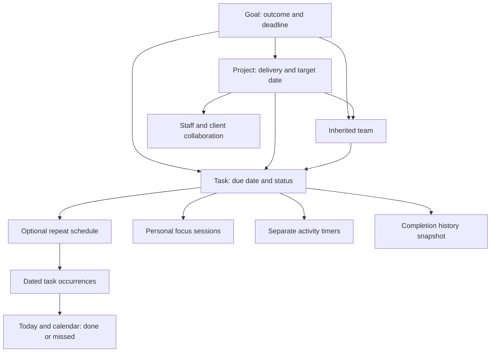

# Product connection audit — 24 October 2026

Web and Android use the same authenticated API and PostgreSQL records. This audit checks integration paths, rather than treating screens as standalone features. Automated tests use disposable fixtures; no real user's tasks are marked complete by testing.

## Work relationships

- A task has one optional project and several optional directly linked goals. It also contributes to its project's goal. Direct and inherited goals are deduplicated for filters and progress; inherited links do not silently become explicit task links.
- Project goal changes immediately affect current counts, filters and inherited teams. Future completion events snapshot both kinds of goals. Historical events remain unchanged; the audit does not invent missing inherited links in old records.
- Project/goal status stays a deliberate choice. Completing every task does not automatically declare the outcome achieved.
- Repetition is a task property. Each occurrence is independent, with a dated done/missed record. Completing today does not complete tomorrow. Editing one occurrence's links does not rewrite every future occurrence.
- Personal focus is one active session per user; ending work does not complete the task. Other people and background activities may work in parallel.

## Verified paths and boundaries

| Path | What is checked | Remaining boundary |
|---|---|---|
| Sign-in → workspace → web/mobile | Shared server session, tenant isolation, email verification, expiry/read-only access | Real-device/network conditions require field testing |
| Task → project → goal | Direct/inherited goal filters and counts, deduplication, team inheritance, immutable completion history | Old snapshots keep their original information |
| Plans → task list | Android opens exact project/goal ID and clears unrelated filters | Users can combine filters again after navigation |
| Repeat → Today → Calendar | Occurrence generation, daily Done/Missed, future projections, calendar deadline editing | Schedules need the existing worker/traffic path to materialize tasks |
| Task → focus → completion | Start/pause/resume/end, single personal focus, cumulative history and explicit completion | No automatic completion from elapsed time |
| Task → reminders / activity | Separate timers, expected check-in, reminder cancellation on completion, native local alerts | Remote device push and physical sound/DND behavior are separate |
| Project/goal → team | Inheritance, explicit task overrides, stale and cross-tenant guards | Staff currently follow workspace access, not project-only visibility |
| Project → client sharing | Restricted email verification, view/contribute permissions, staff/client message persistence and refresh | 100-message comment thread; no typing/read receipts or global messenger |
| Project → files | Size/type validation, quarantine, authorized private download | Trusted antivirus worker must be hosted to release new uploads |
| Plans → estimated reward → finance | Planning estimates stay separate from ledger; invoices/receipts/refunds/commissions tested | Payment gateway still needs production credentials/setup |
| Lead → applicant → applications | Lead conversion, independent applicant/application stages, multiple applications, drag/drop | Applications are tracked here, not submitted to university portals |
| Email → matched applicant/application | Exact email/reference matching, ambiguous review, replay/stale guards | Live Gmail OAuth/sync and sending require configured provider credentials |
| Documents → OCR → facts → forms | Page evidence, student/staff review, manual replacement consent, tenant privacy, extension mapping | Real document variety and inaccessible third-party widgets need manual review |
| Chat → proposals → approved action | Task/CRM changes, explicit review, idempotent approval, history pagination | Local command mode and live model are distinct; audit does not claim external messages were sent |
| WhatsApp → company inbox/outbox | Company isolation, pairing controls and reviewed outbox | Separate persistent WhatsApp worker/connection required; no Vercel background browser |
| Subscription/voucher → permissions | Roles, 15-day trial, feature access, owner email restriction, redemption/email guards | Gateway billing is not enabled by these checks |

## Fixes from this audit

1. Goal filters and project/goal progress now include tasks contributing through a project's goal on both clients.
2. Android plan navigation uses stable IDs and resets unrelated filters instead of searching by a title, avoiding duplicate-name matches and accidentally empty lists.
3. Task link controls explain the inherited goal. Direct goal selections remain independently editable.
4. New database event snapshots include inherited project goals exactly once; existing historical records are preserved.
5. Web contributing-task titles open full task details; Android project cards show their supported goal.
6. Android About version now matches the testing release.

## Evidence

- Baseline compiled full suite: 162/162 passed (`.data/connections-full-tests.log`). Includes CRM, permissions, sharing, finance, document/OCR, extension mapping, tasks, focus, alerts, email flows and performance boundaries.
- Relationship regression coverage: `tests/task-connections.mjs` checks inherited-only goal contribution, direct/inherited deduplication, team membership and history after removing the project's goal. Browser checks verify goal progress and task filters.
- Shared layout/accessibility audit: 20 web viewports plus mobile tab audits. These are automated checks, not a guarantee of every assistive technology or physical device.
- Migration 029 tested on expiring Neon branch `audit-connections-20261024`, then a synthetic inherited-only completion was verified and rolled back. Existing production records were not edited for QA.
- Native acceptance includes actual touch/keyboard/notification interactions and project-to-goal task navigation. Final run results are recorded in the release notes.

Performance limits remain: workspace bootstrap still returns full collections, large lists need pagination/virtualization, and project comments have a fixed cap. Local response benchmarks are not a production load-capacity claim. See PERFORMANCE_AUDIT.md and TASK_PLANNING.md.

Android acceptance: 27/27 passed (`.data/connections-final-android.log`). Normal APK 0.2.9 / code 11 signature verified and installed over the previous build. Migration 029 applied to the configured direct Neon runtime endpoint after branch validation; temporary branch removed.

Final compiled suite: 163 tests, 162 passed in one run; browser touch test exposed a DOM-refresh race in the test itself after a successful database save. It now waits for the card in the destination column and for cancellation to render. Both touch regressions passed on rerun (`.data/connections-touch-verified.log`). The new relationship/browser test passed in the full run. Final web/mobile builds passed; native 27/27 and 20-view accessibility audit passed. No production load-capacity claim is made.
